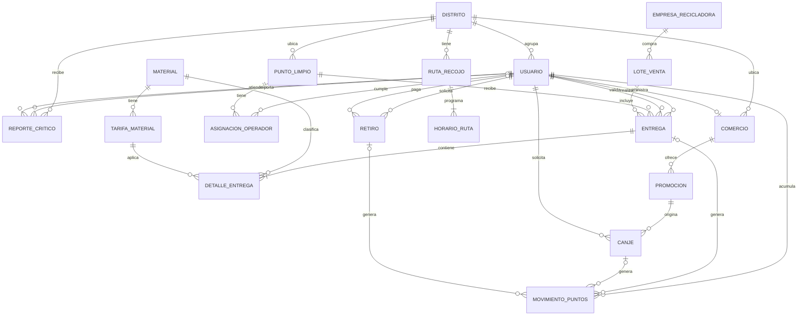
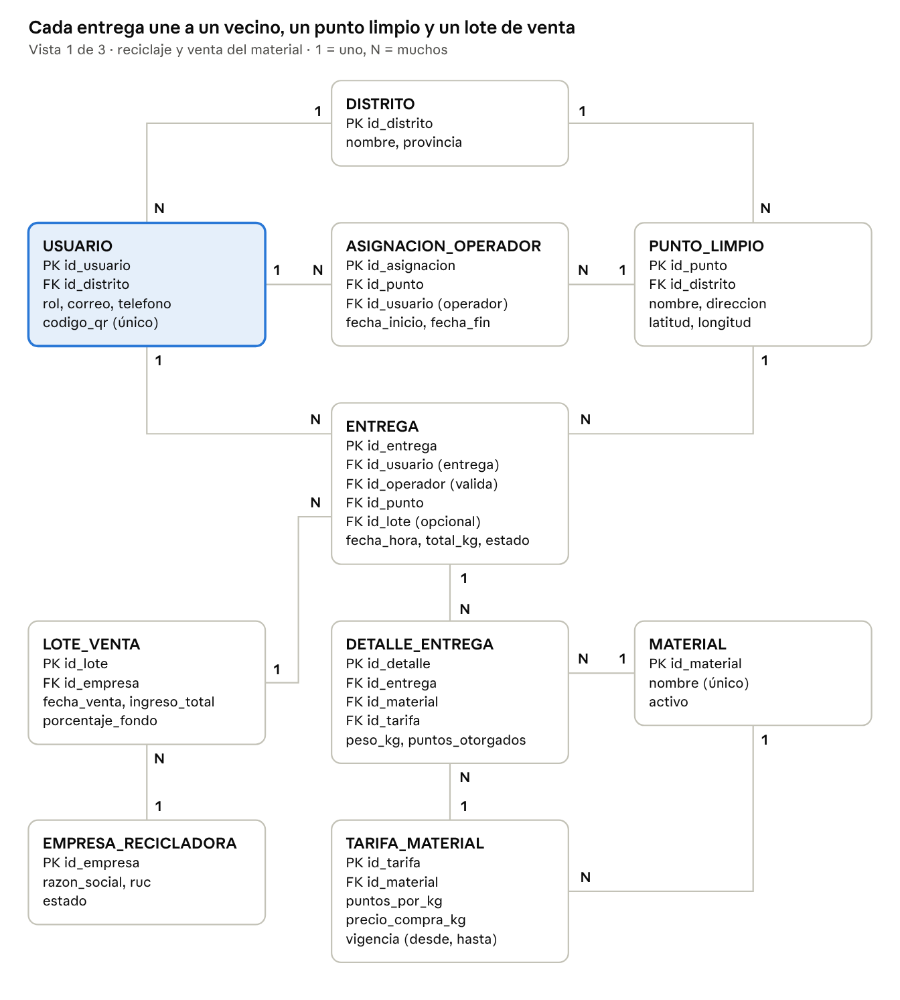
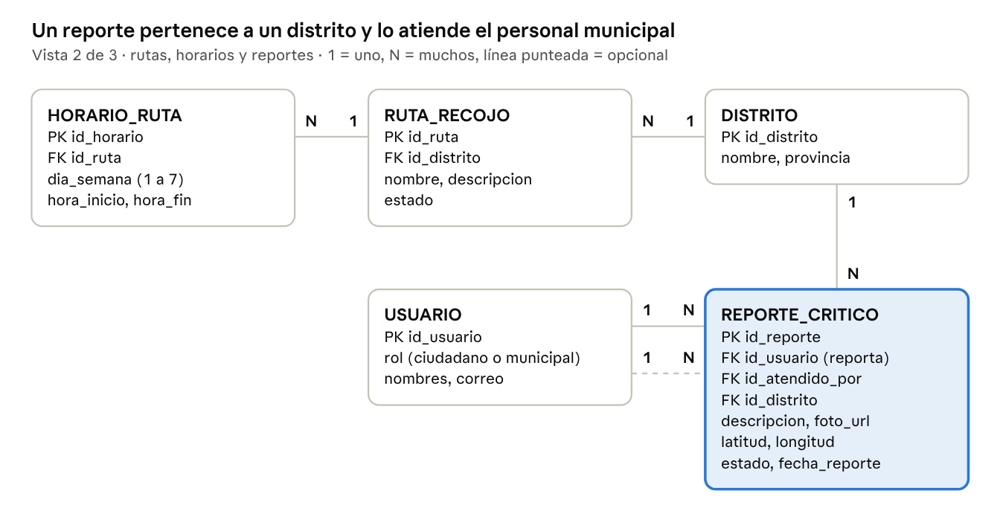
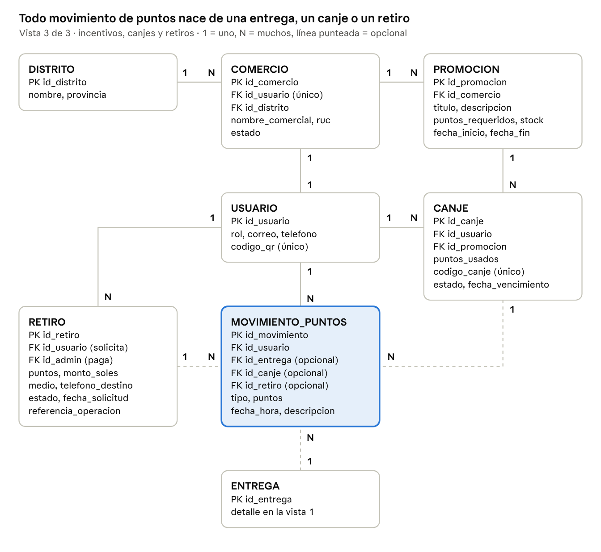

# Diagrama entidad-relación

## Vista 1: reciclaje y venta del material

## Vista 2: rutas, horarios y reportes

## Vista 3: incentivos, canjes y retiros

## Cardinalidades

| N.º | Relación                            | Cardinalidad   | Clave foránea                   | Significado                                                                    |
|-----|-------------------------------------|----------------|---------------------------------|--------------------------------------------------------------------------------|
| 1   | DISTRITO – USUARIO                  | 1:N            | usuario.id_distrito             | Un distrito agrupa a muchos usuarios                                           |
| 2   | DISTRITO – PUNTO_LIMPIO             | 1:N            | punto_limpio.id_distrito        | Un distrito tiene varios puntos limpios                                        |
| 3   | DISTRITO – RUTA_RECOJO              | 1:N            | ruta_recojo.id_distrito         | Un distrito tiene varias rutas                                                 |
| 4   | DISTRITO – REPORTE_CRITICO          | 1:N            | reporte_critico.id_distrito     | Un distrito recibe muchos reportes                                             |
| 5   | DISTRITO – COMERCIO                 | 1:N            | comercio.id_distrito            | Un distrito tiene varios comercios afiliados                                   |
| 6   | USUARIO – COMERCIO                  | 1:1            | comercio.id_usuario (único)     | Un usuario con rol comercio administra un solo comercio                        |
| 7   | USUARIO – ASIGNACION_OPERADOR       | 1:N            | asignacion_operador.id_usuario  | Un operador puede tener varias asignaciones                                    |
| 8   | PUNTO_LIMPIO – ASIGNACION_OPERADOR  | 1:N            | asignacion_operador.id_punto    | Un punto tiene varios operadores; junto con la anterior forma una relación N:M |
| 9   | USUARIO – ENTREGA (entrega)         | 1:N            | entrega.id_usuario              | Un ciudadano o comercio realiza muchas entregas                                |
| 10  | USUARIO – ENTREGA (valida)          | 1:N            | entrega.id_operador             | Un operador valida muchas entregas                                             |
| 11  | PUNTO_LIMPIO – ENTREGA              | 1:N            | entrega.id_punto                | Un punto recibe muchas entregas                                                |
| 12  | ENTREGA – DETALLE_ENTREGA           | 1:N            | detalle_entrega.id_entrega      | Una entrega incluye uno o más materiales                                       |
| 13  | MATERIAL – DETALLE_ENTREGA          | 1:N            | detalle_entrega.id_material     | Un material aparece en muchos detalles                                         |
| 14  | MATERIAL – TARIFA_MATERIAL          | 1:N            | tarifa_material.id_material     | Un material tiene varias tarifas a lo largo del tiempo                         |
| 15  | TARIFA_MATERIAL – DETALLE_ENTREGA   | 1:N            | detalle_entrega.id_tarifa       | Una tarifa se aplica a muchos detalles                                         |
| 16  | EMPRESA_RECICLADORA – LOTE_VENTA    | 1:N            | lote_venta.id_empresa           | Una empresa compra muchos lotes                                                |
| 17  | LOTE_VENTA – ENTREGA                | 1:N (opcional) | entrega.id_lote                 | Un lote reúne muchas entregas; una entrega puede no estar vendida aún          |
| 18  | RUTA_RECOJO – HORARIO_RUTA          | 1:N            | horario_ruta.id_ruta            | Una ruta tiene varios horarios                                                 |
| 19  | USUARIO – REPORTE_CRITICO (reporta) | 1:N            | reporte_critico.id_usuario      | Un ciudadano envía muchos reportes                                             |
| 20  | USUARIO – REPORTE_CRITICO (atiende) | 1:N (opcional) | reporte_critico.id_atendido_por | Un funcionario atiende muchos reportes                                         |
| 21  | COMERCIO – PROMOCION                | 1:N            | promocion.id_comercio           | Un comercio publica varias promociones                                         |
| 22  | PROMOCION – CANJE                   | 1:N            | canje.id_promocion              | Una promoción se canjea muchas veces                                           |
| 23  | USUARIO – CANJE                     | 1:N            | canje.id_usuario                | Un ciudadano realiza muchos canjes                                             |
| 24  | USUARIO – RETIRO (solicita)         | 1:N            | retiro.id_usuario               | Un ciudadano solicita muchos retiros                                           |
| 25  | USUARIO – RETIRO (paga)             | 1:N (opcional) | retiro.id_admin                 | Un administrador registra muchos pagos                                         |
| 26  | USUARIO – MOVIMIENTO_PUNTOS         | 1:N            | movimiento_puntos.id_usuario    | Un usuario acumula muchos movimientos                                          |
| 27  | ENTREGA – MOVIMIENTO_PUNTOS         | 1:N (opcional) | movimiento_puntos.id_entrega    | Una entrega genera su acreditación y, si se anula, su reversión                |
| 28  | CANJE – MOVIMIENTO_PUNTOS           | 1:N (opcional) | movimiento_puntos.id_canje      | Un canje genera su descuento y, si vence, su devolución                        |
| 29  | RETIRO – MOVIMIENTO_PUNTOS          | 1:N (opcional) | movimiento_puntos.id_retiro     | Un retiro genera su descuento de puntos                                        |
