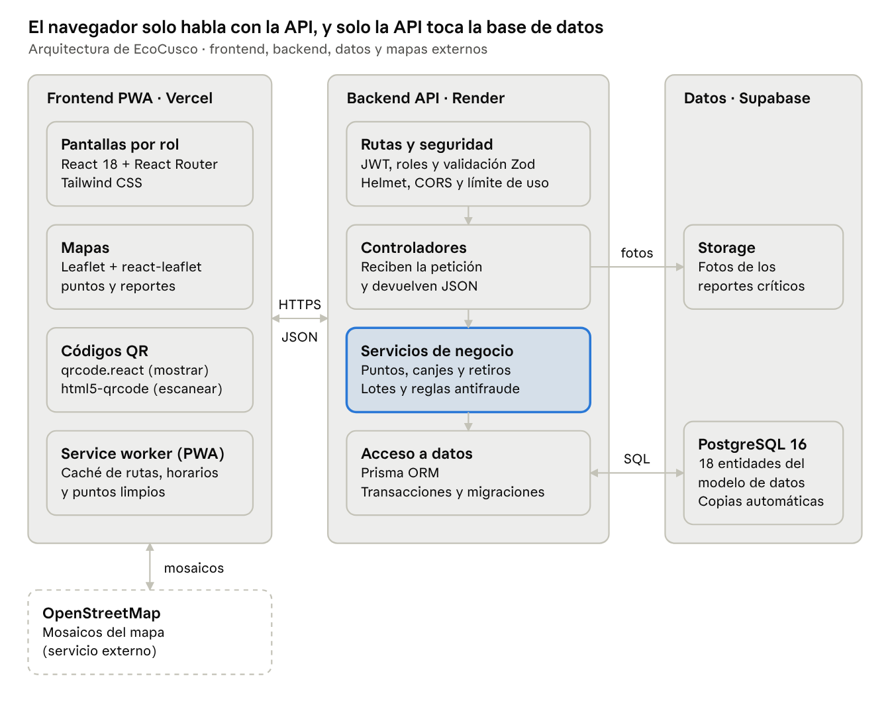

# 6. Evidencia 4 – Arquitectura del sistema

EcoCusco usa una arquitectura cliente-servidor en tres capas: una PWA en
React, una API REST en Node.js y una base de datos PostgreSQL con
almacenamiento de fotos, todo en servicios gestionados. El frontend
nunca accede a la base de datos: toda petición pasa por la API, que
aplica la seguridad y las reglas de negocio.

Las flechas dobles indican petición y respuesta; la flecha simple hacia
Storage indica que solo se escriben y leen fotos por intermedio de la
API. El recuadro destacado es donde viven las reglas de negocio (RN-01 a
RN-13).

## 6.1 Ejemplo de comunicación: registro de una entrega

1.  El operador escanea el QR del ciudadano con la cámara
    (html5-qrcode), elige los materiales, ingresa los pesos y la PWA los
    envía por HTTPS en formato JSON.

2.  La API valida el token JWT y el rol de operador, y los servicios de
    negocio comprueban el punto asignado, el límite diario de 20 kg y la
    tarifa vigente de cada material.

3.  En una sola transacción de Prisma se guardan la ENTREGA, su
    DETALLE_ENTREGA y el MOVIMIENTO_PUNTOS de acreditación; si algo
    falla, no se guarda nada.

4.  La API responde con los puntos otorgados y el ciudadano ve su nuevo
    saldo al abrir su historial.

## 6.2 Decisiones de arquitectura

- **API única.** Concentrar la lógica en el backend protege las reglas
  de negocio y los saldos, que no pueden depender del navegador.

- **PWA con caché.** Las rutas, los horarios y los puntos limpios se
  consultan sin conexión, lo que atiende a vecinos con internet
  inestable (RNF-08).

- **Servicios gestionados.** Vercel, Render y Supabase evitan
  administrar servidores y mantienen el costo del piloto bajo.

- **Capas separadas en el backend.** Rutas, controladores, servicios y
  acceso a datos se pueden probar y cambiar por separado (RNF-09).
